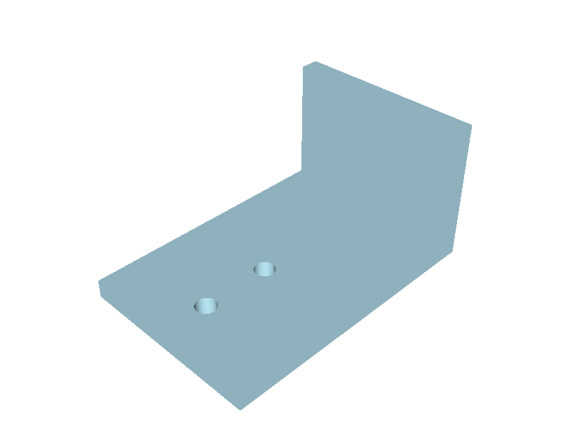
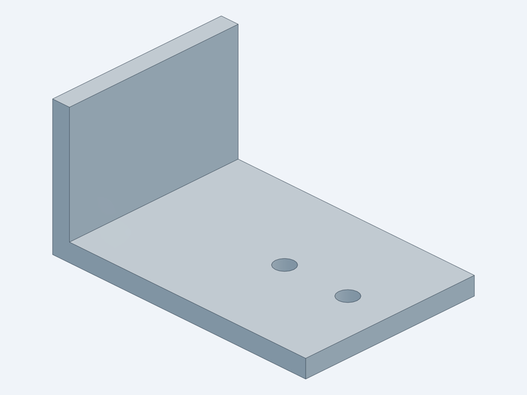
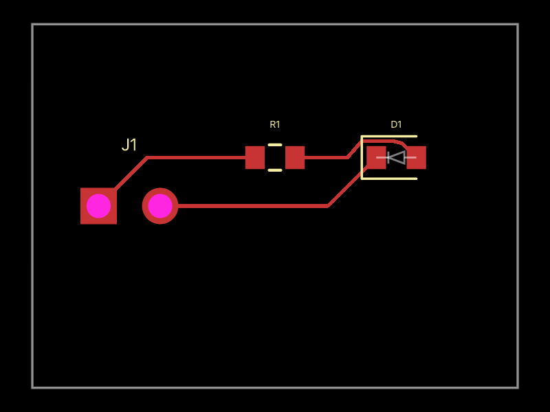

# Quality report

English · [한국어](quality-report.ko.md)

Tested 2026-10-16 on macOS (Apple Silicon) with Codex CLI 0.151.0, KiCad 10.0.6 and Fusion 2704.1.23.

Each tool got the same small task, and we checked the result itself rather than the tool's "success" message:
volumes against a hand calculation, KiCad results against `kicad-cli`, and G-code checks against faults we injected on purpose.

## Summary

| Tool | Score | Task | Result |
|---|---|---|---|
| text-to-cad (cadgen 0.7.21) | 5/5 | L-bracket to STEP, STL and a render | 13,638.36 mm³, matches hand calculation |
| build123d-mcp 0.3.91 | 5/5 | Same bracket through MCP | Volume and size match; STEP, STL, PNG written |
| AgentCADCAM | 4/5 | Own test suite; injected G-code faults | 657 tests pass; 3 of 3 faults caught |
| KiCAD-MCP-Server (mixelpixx) | 4/5 | Open a KiCad demo, DRC, Gerbers | DRC 0; 21 Gerbers and a drill file |
| kicad-mcp-pro 4.3.0 | 4/5 | ERC, DRC and quality gate on the demo | ERC/DRC 0, same as `kicad-cli` |
| tscircuit (tsci 0.0.2916) | 4/5 | LED board to fab files | Caught a reversed LED; full fab set |
| atopile 0.15.9 | 2/5 | Official quickstart build | Stops at part picking: account sign-in required |
| Fusion built-in MCP | pending | | Needs a signed-in Fusion session |
| faust fusion360-mcp-server | pending | Server start | 93 tools from the pinned checkout; live test pending |
| freecad-mcp, mcp-for-blender | not rated | Server start only | 17 and 9 tools; apps not installed |

## Mechanical

### build123d-mcp



- Task: 60 × 40 × 30 mm L-bracket, 4 mm thick, two 4.4 mm holes.
- Hand calculation: 344 mm² section × 40 mm − 2 × π × 2.2² × 4 = 13,638.4 mm³.
- Tool: 13,638.3575 mm³, bounding box 60 × 40 × 30, 10 faces, both 4.4 mm cylinders recognised.
- Good: `measure` returns centre of mass, inertia and a face inventory, so results can be checked without a picture. Writes are confined to the server's working directory.
- Watch: exports outside the working directory are rejected. In Codex the project folder is the working directory, so this does not get in the way.

### text-to-cad



- Same bracket as a model script (`@step`, `@stl`): STEP 30 KB, STL 34 KB.
- Re-imported volume 13,638.36 mm³, matching build123d-mcp.
- Best renders of the set, and it bundles drawing, DXF, DFM, slicing and fab-service skills.
- Watch: usage telemetry is on by default upstream; the installer turns it off.

## CAM

### AgentCADCAM

- Foundation check, 108 schema instances and 657 unit tests pass.
- Fault injection on the bundled milling program:

| Injected fault | Caught |
|---|---|
| Feed moves with the spindle never started | Flags all 5 lines |
| Rapid move down to Z−5 | "Z-5 exceeds declared fixture coordinate bound" |
| mm switched to inch (G21 → G20) | Blocks on unit conflict and unsupported command |

- Good: it never grants permission to run; every result carries "human approval" and "simulation" blockers, and it states what it did not check.
- Watch: machine, tool and controller context must be filled in as JSON for the checks to mean anything. New project with one star, hence 4.

## Electronics

### KiCAD-MCP-Server (mixelpixx)

- KiCad demo `pic_programmer` (63 footprints, 370 tracks).
- Open project, board info (160 × 99 mm), DRC 0, 21 Gerbers plus a drill file.
- Good: covers editing, routing, autorouting, part search (JLCPCB, DigiKey) and every fab export.
- Watch: 244 tools, so find them with `search_tools`. A call in the first second after start can fail with "Python process is not running"; retry. Gerber export plots every layer unless `layers` is given.

### kicad-mcp-pro

- Same demo: ERC 0, DRC 0, identical to running `kicad-cli` directly.
- Good: read-only by default, and each result carries PASS/WARN/FAIL plus a next action.
- Watch: `pcb_visual_qa` wrongly reported five parts as off-board.

### KiCad first-run problem

With KiCad never opened, the global library tables do not exist, and ERC/DRC report 44 and 41 "library not in configuration" warnings. Copying `fp-lib-table` and `sym-lib-table` from KiCad's template folder brings both to 0. The installer does this.

### tscircuit



- Task: 2-pin header, 330 Ω resistor and red LED on a 20 × 15 mm board.
- Output: 10 Gerber layers, drill, BOM with JLCPCB part numbers, pick-and-place, STEP.
- Real catch: the auto-picked JLCPCB LED (C3030991) has pin 1 as cathode, while the circuit used pin 1 as anode. The build failed until `pinLabels` matched; built as drawn, the LED would not have lit.
- Cross-check: exported to KiCad and run through `kicad-cli`: 26 violations, from 0.15 mm tracks and 0.13 mm clearance against KiCad's 0.2 mm defaults. JLCPCB's standard process can make this, but with little margin.

### atopile

- Installs (0.15.9) and compiles, then stops at part picking with "Sign-in required".
- The project is moving to app.atopile.io, which makes it a poor fit for offline personal work today.
- Most bundled skills target atopile's own agent and contributors (compiler, LSP, Zig bindings).

## Start-up only

| Tool | Result | Why not further |
|---|---|---|
| faust fusion360-mcp-server | PyPI 0.1.0 exits at start with `mcp>=2`; the pinned checkout runs with 93 tools | Waiting for a signed-in Fusion |
| freecad-mcp 0.1.27 | Starts with 17 tools | FreeCAD not installed |
| mcp-for-blender 2.1.9 | Starts with 9 tools; anonymous usage telemetry by default | Blender not installed |

## Reproduce

```bash
./install.sh --check
uv run --with mcp scripts/mcp_probe.py -v -- uvx kicad-mcp-pro==4.3.0
```

